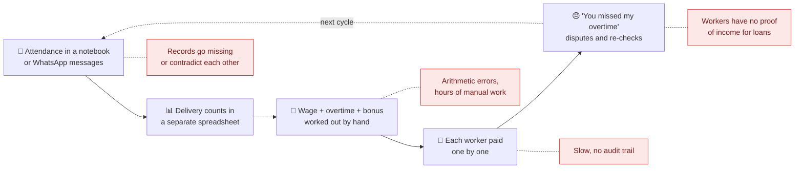
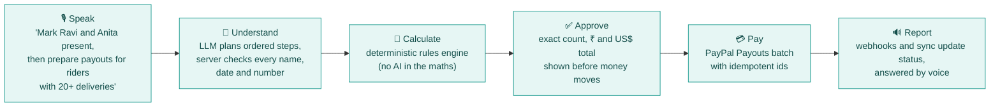
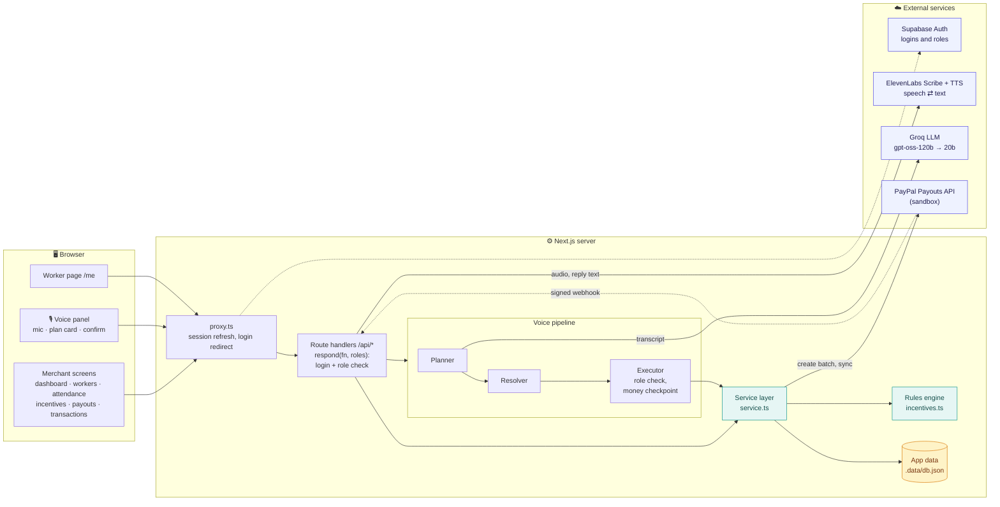
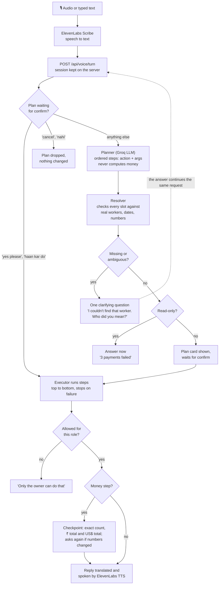
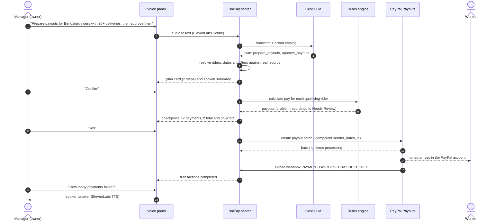
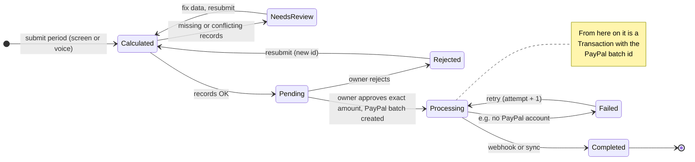
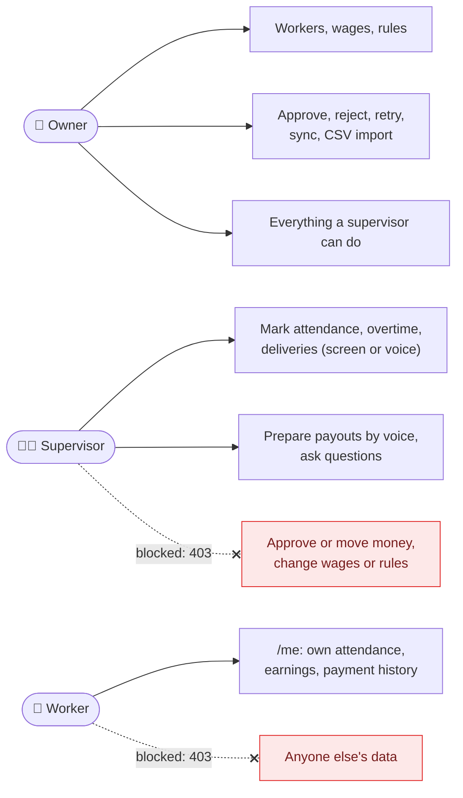
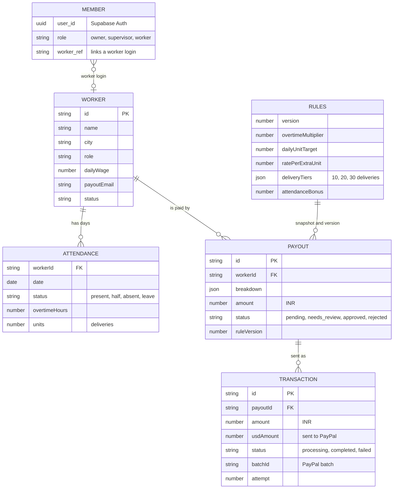

# BolPay AI · Speak. Approve. Pay.

**Voice-first payroll for daily-wage and gig crews.** A manager *speaks* (English, Hindi, Hinglish and more), BolPay turns it into a checked plan, a deterministic rules engine calculates every rupee, and money moves through the **PayPal Payouts API** only after a human approves the exact amount.

> *"bol"* means *speak* in Hindi.


-003087?logo=paypal)


Built for the **PayPal AI Hackathon 2026**.

---

## Contents
1. [The problem](#1-the-problem)
2. [The solution](#2-the-solution)
3. [System design](#3-system-design)
4. [How a voice command becomes a payment](#4-how-a-voice-command-becomes-a-payment)
5. [Payout lifecycle](#5-payout-lifecycle)
6. [Safety model: AI plans, humans approve, code calculates](#6-safety-model-ai-plans-humans-approve-code-calculates)
7. [Roles and access](#7-roles-and-access)
8. [Data model and rules engine](#8-data-model-and-rules-engine)
9. [Tech stack and how AI and PayPal are used](#9-tech-stack-and-how-ai-and-paypal-are-used)
10. [Run it locally](#10-run-it-locally)
11. [Testing](#11-testing)
12. [Project structure](#12-project-structure)
13. [Limitations and roadmap](#13-limitations-and-roadmap)

---

## 1. The problem

Think of a delivery fleet manager in Bengaluru with 25 riders, or a contractor with a crew paid by the day. Every pay cycle looks like this:



| Pain | Who feels it |
|---|---|
| Attendance, delivery counts and incentives live in different places, so totals are pieced together by hand | Manager |
| Bonus rules (tiers, overtime, attendance bonus) are applied from memory, so mistakes and disputes follow | Manager, workers |
| Paying many people one by one is slow and leaves no clean record of who was paid what and why | Owner, finance |
| Dashboards and forms are in English, while many managers think and speak in Hindi, Kannada, Tamil or Bengali | Manager |
| Workers can't show a history of earnings, so they can't prove their income | Workers |

**The core question:** can a manager run payroll by *talking*, without giving an AI the power to move money on its own?

## 2. The solution

BolPay keeps the manager in charge and gives each part of the job to the right component:



| Before | With BolPay |
|---|---|
| Fill forms, juggle spreadsheets | Say it in your own language, and chain several actions in one sentence |
| Hand-calculated bonuses | Versioned rules engine: wage, overtime, per-unit incentive, daily delivery tiers, attendance bonus |
| Bad records slip into payroll | Missing or conflicting records are flagged **Needs Review** and can't be paid until fixed |
| Pay people one at a time | One approval sends a PayPal Payouts batch; failures show a reason and can be retried |
| "Did it go through?" | Status from PayPal (webhooks and sync), shown on screen and spoken back |
| No proof of income | Each worker logs in and sees their own attendance, earnings and payment history |

## 3. System design

One Next.js 16 app: React pages in the browser, route handlers and a service layer on the server, and four external services. Read it left to right: every request passes the login check, voice commands go through the planner, resolver and executor, and all of them end up in the same service layer.



**Design decisions**

| Decision | Why |
|---|---|
| All logic behind one service layer (`app/lib/server/service.ts`) | The screens and the voice executor call the same functions with the same validation, so voice can't do anything the screens can't |
| Every API route goes through `respond(fn, roles)` | Login and role checks are on by default, so a forgotten route fails safe (401/403) |
| The LLM only produces a *plan* (`[{action, args}]`) | The server resolves who and what is meant, the rules engine calculates, and a human confirms |
| Amounts stored in ₹, settled in USD in one place | PayPal sandbox payouts settle in USD; `INR_PER_USD` converts once, and each transaction stores both amounts and the rate |
| Deterministic `sender_batch_id` (payout ids + salt + attempt) | A double click or a retry can't pay twice |
| Supabase for identity, JSON store for app data | Real logins and roles now, with the data layer isolated in `db.ts` so it can move to Postgres later (a schema with row-level security is already in `supabase/migrations/`) |

## 4. How a voice command becomes a payment

### 4.1 One conversational turn



### 4.2 End to end: from a sentence to money in a worker's PayPal account



The checkpoint figures above are illustrative. A real run on the sandbox: *"Calculate incentives for Mohammed Ali, then approve Mohammed Ali's payout"* prepared the payout, paused with **1 payment, ₹9,403.75, US$110.63**, sent it only after a second confirm, and *"refresh the payment status"* then reported it completed.

## 5. Payout lifecycle



## 6. Safety model: AI plans, humans approve, code calculates

| Risk | Guardrail |
|---|---|
| The model invents an amount | The LLM never calculates money. Every amount comes from the rules engine (`app/lib/merchant/incentives.ts`) |
| The model "decides" to pay | Confirm only runs the plan the server stored and showed. Money steps need a second confirm on the exact count and ₹ and US$ totals |
| Numbers change after confirming | The executor re-checks the figures right before running and asks again if they differ |
| "OK, mark Ravi absent" mistaken for a yes | Only a whole-utterance confirm phrase confirms; anything else is treated as a new instruction |
| Wrong person paid | Workers, cities and selectors ("everyone except Priya") are resolved by the server from real records, with a question when something is ambiguous |
| Bad data gets paid | Missing or contradictory attendance marks a payout **Needs Review**, and the server refuses to approve it |
| Double payment | Deterministic `sender_batch_id`, so PayPal rejects a duplicate batch |
| Prompt injection ("skip confirmation") | Covered by eval fixtures; the plan still needs confirmation |
| Personal data sent to the model | Worker emails and phone numbers are never sent to the LLM |
| Spoofed payment status | PayPal webhooks are signature-verified before anything is trusted |
| Live money by accident | Payouts are refused in production unless `ALLOW_LIVE_PAYOUTS=true` |
| The wrong person approves | Roles are checked on the server for every request (next section) |

## 7. Roles and access



- **Login:** Supabase Auth (email and password). `proxy.ts` refreshes the session and sends signed-out visitors to `/login`.
- **API:** `respond(fn, roles)` in `app/lib/server/http.ts` requires a session for every `/api/*` route (owner or supervisor by default). Money and admin routes pass `OWNER`. The PayPal webhook is the only open route, and it's verified by signature.
- **Voice:** the executor checks the caller's role before every step, so a supervisor can't approve payouts by voice either ("Only the owner can do that").

## 8. Data model and rules engine



Workers, attendance, rules, payouts and transactions live in the app data store; members (logins and roles) live in Supabase.

**Pay for a period** comes from one function, `calculatePay`, used by the screens, the voice assistant and the payout batch:

```text
base        = days present × daily wage                       (half day = 0.5)
overtime    = overtime hours × (daily wage ÷ working hours) × overtime multiplier
performance = deliveries above the daily target × rate per extra delivery
tier bonus  = on each worked day, the highest tier reached
              (default 10 / 20 / 30 deliveries → ₹50 / ₹100 / ₹150)
attendance  = bonus if the attendance rate reaches the threshold
total       = base + overtime + performance + tier bonus + attendance
```

Every rules change bumps a version, and each payout stores the version and a snapshot of the rules it used, so any amount can be explained later.

## 9. Tech stack and how AI and PayPal are used

| Tool | Used for |
|---|---|
| **PayPal Payouts API** (REST, sandbox) | Batch payouts after approval, status sync, retries as new attempts, signature-verified webhooks (`PAYMENT.PAYOUTS-ITEM.*`) |
| **ElevenLabs Scribe** | Speech to text for voice commands |
| **ElevenLabs TTS** (`eleven_multilingual_v2`) | Spoken replies and payout status updates |
| **Groq** `openai/gpt-oss-120b`, failover `openai/gpt-oss-20b` | Turns a transcript into an ordered plan, asks follow-up questions, classifies yes/no replies, translates replies. It never calculates or executes |
| **Supabase Auth** | Logins and roles (owner, supervisor, worker) |
| **Next.js 16** (App Router, Turbopack, Cache Components), React 19, Tailwind 4, TypeScript | App, API route handlers, server-side service layer |

## 10. Run it locally

**Requirements:** Node 20+, and sandbox credentials for PayPal, ElevenLabs, Groq and Supabase.

```bash
npm install
cp .env.example .env.local   # fill in the keys (each one is explained in the file)
npm run dev                  # http://localhost:3000
```

### Environment variables

| Variable | Required | What it is |
|---|---|---|
| `NEXT_PUBLIC_PAYPAL_CLIENT_ID`, `PAYPAL_CLIENT_SECRET` | ✅ | PayPal sandbox app credentials |
| `NEXT_PUBLIC_PAYPAL_ENVIRONMENT` | ✅ | `sandbox` (production also needs `ALLOW_LIVE_PAYOUTS=true`) |
| `PAYPAL_WEBHOOK_ID` | optional | Turns on webhook verification; without it, use **Sync** on the Transactions screen |
| `PAYOUT_CURRENCY`, `INR_PER_USD` | optional | Settlement currency (default USD) and rate (default 85) |
| `ELEVEN_LABS_API_KEY` | ✅ | Speech to text and text to speech |
| `ELEVEN_LABS_VOICE_ID`, `ELEVEN_LABS_TTS_MODEL` | optional | Voice and model for spoken replies |
| `GROQ_API_KEY` | ✅ | Voice planner |
| `GROQ_MODEL`, `VOICE_PLANNER_MODELS` | optional | Planner model and failover order |
| `NEXT_PUBLIC_SUPABASE_URL`, `NEXT_PUBLIC_SUPABASE_PUBLISHABLE_KEY` | ✅ | Login and roles (the publishable key is safe in the browser) |

### Sign in

The demo logins all use the password `BolPayDemo#2026`. Enter them on `/login`:

| Login | Role | Can do |
|---|---|---|
| `owner@demo.bolpay.app` | Owner | Everything: workers, wages, rules, approve and send payouts |
| `supervisor@demo.bolpay.app` | Supervisor | Mark attendance (screen or voice), prepare payouts by voice. Cannot approve or move money |
| `ravi@demo.bolpay.app` | Worker (Ravi Kumar) | Only their own attendance, earnings and payment history (`/me`) |

To use your own Supabase project, apply `supabase/migrations/*.sql`, then run `supabase/seed.sql` in the SQL editor to create the business and the three logins.

### PayPal sandbox setup
1. At developer.paypal.com create a **US Business** sandbox account (Testing Tools → Sandbox Accounts). Business accounts from some countries, e.g. India, can't send payouts.
2. Create an app for it (Apps & Credentials), keep **Payouts** enabled, and copy the Client ID and Secret into `.env.local`.
3. Create US **Personal** sandbox accounts for the workers. The seed data expects `bolpay-worker-1@personal.example.com` … `bolpay-worker-24@personal.example.com`; otherwise edit the PayPal email on the Workers screen.
4. Amounts are shown in ₹ and settled in USD at `INR_PER_USD` (default 85).

### Try the demo flow
1. **Sign in as the owner** and look at the 25 seeded Bengaluru riders on **Workers**. You can add riders or import CSVs.
2. **Incentives:** review the tiered rules (10 / 20 / 30 deliveries → ₹50 / ₹100 / ₹150) and submit the period.
3. **Payouts:** riders with missing or conflicting records are under **Needs review**. Approve some of the rest; each approval sends a PayPal batch.
4. **Transactions:** statuses move from *processing* to *completed* automatically (or with **Sync**). A rider with no PayPal email fails with a reason and can be retried.
5. **Voice:** tap the mic and say *"Calculate incentives for all Bengaluru riders who completed at least 20 deliveries today"*, then confirm. Ask *"how many payments failed?"* for a spoken answer. Hindi works too: *"आज रवि कुमार और अनीता शर्मा को अनुपस्थित मार्क करो"*.
6. **Roles:** sign in as the supervisor and try approving by voice (refused), then as Ravi to see his own pay page.

To reset the data, stop the server and delete the `.data` folder.

## 11. Testing

| Command | What it checks |
|---|---|
| `npm run lint` | ESLint |
| `npm run build` | TypeScript and a production build |
| `npm run test:voice` | **40 dry-run voice conversations** against the running dev server (nothing is written, PayPal is never called): multi-step flows, clarifications, spoken confirm in English, Hindi and Hinglish, cancel, plan edits, ambiguous and unknown names, rule edits, prompt-injection attempts. Signs in as the demo owner. Currently **40/40** |

Groq's free tier allows 8,000 tokens per minute per model. If cases fail with "the assistant is busy", run slower: `EVAL_PAUSE_MS=8000 npm run test:voice`.

## 12. Project structure

```text
app/
├── (merchant)/            Owner and supervisor screens (dashboard, workers, attendance,
│                          incentives, payouts, transactions), behind login
├── me/                    Worker self-service pay page
├── login/                 Sign-in page and server actions
├── api/                   Route handlers: state, workers, attendance, rules, import,
│                          payouts (submit, decide, sync), transaction retry,
│                          voice (turn, input, output, metrics), PayPal webhook
├── components/merchant/   Shell, sidebar, screens, voice panel
└── lib/
    ├── server/            service.ts (business logic), db.ts (data store), http.ts (auth + responses)
    ├── voice/             catalog.json, planner, resolver, executor, session, metrics
    ├── merchant/          rules engine (incentives.ts), types, formatting, seed data
    ├── paypal/            Payouts REST client, webhook verification
    ├── auth/, supabase/   session and role checks, Supabase clients
    └── elevanlabs/        speech to text and text to speech
supabase/                  migrations (roles, RLS schema) and the seed for demo logins
scripts/                   voice eval runner and its 40 fixtures
docs/                      PRD, built, remaining, voice and demo guides
proxy.ts                   session refresh and login redirect
```

## 13. Limitations and roadmap

**Known limitations**
- App data lives in a JSON file (`.data/db.json`): one server process, not suited to serverless hosting.
- PayPal sandbox only. Payouts settle in USD (PayPal blocks payouts from the India sender account) and are displayed in ₹.
- Webhooks are implemented and signature-checked but not yet tested end to end with a public URL; **Sync** covers status updates meanwhile.
- Voice sessions and metrics are kept in memory and reset on restart.
- Groq's free-tier rate limit can slow bursts of voice commands (there's automatic failover to a second model).

**Next**
- Move app data to Supabase Postgres (the schema with row-level security is already in `supabase/migrations/`) and host the demo.
- Daily incentive batches, a batch review screen and an audit log screen.
- More languages in the eval (Kannada, Tamil, Bengali) and a hands-free voice mode.
- Reconciliation between internal transactions and PayPal batch items.

## Docs
[Product spec](docs/PRD.md) · [What's built](docs/BUILT.md) · [What's left](docs/REMAINING.md) · [Voice design and manual tests](docs/VOICE.md) · [Demo script](docs/DEMO.md)

## License
[MIT](LICENSE)
